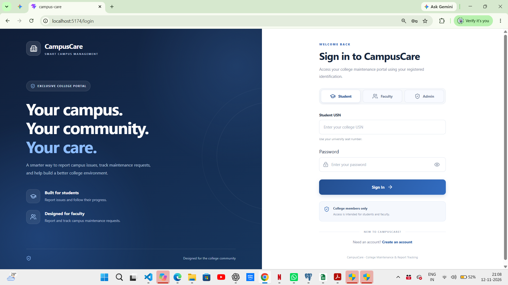
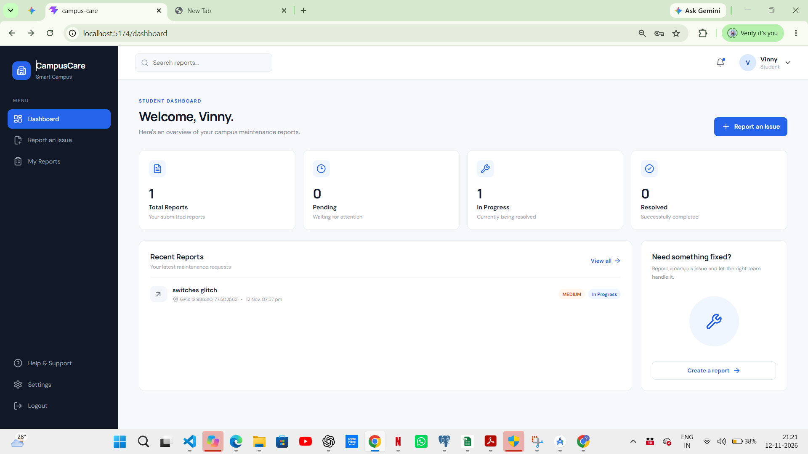
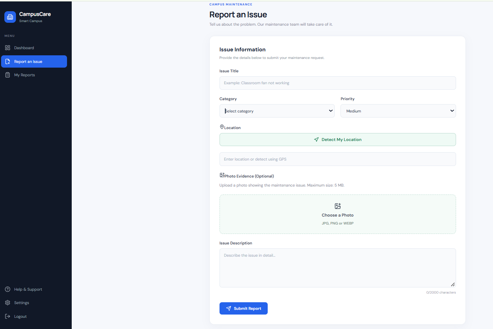
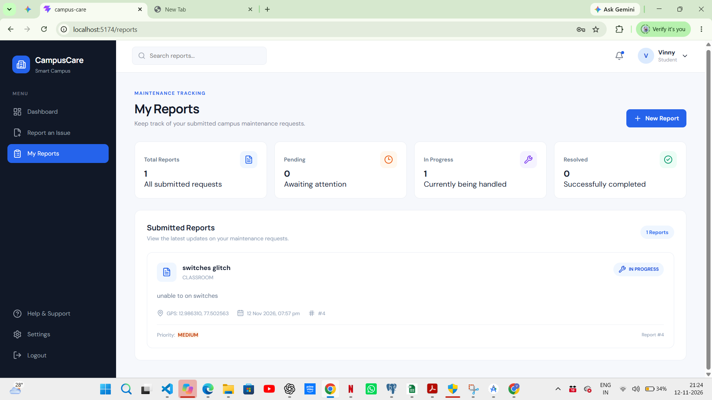
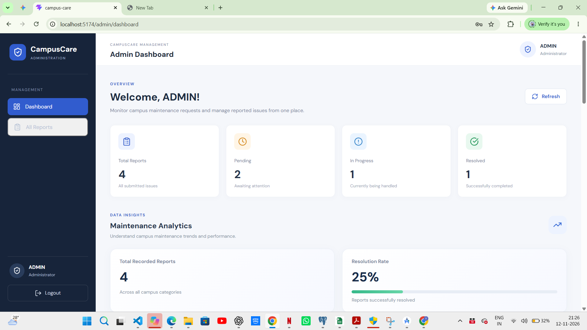
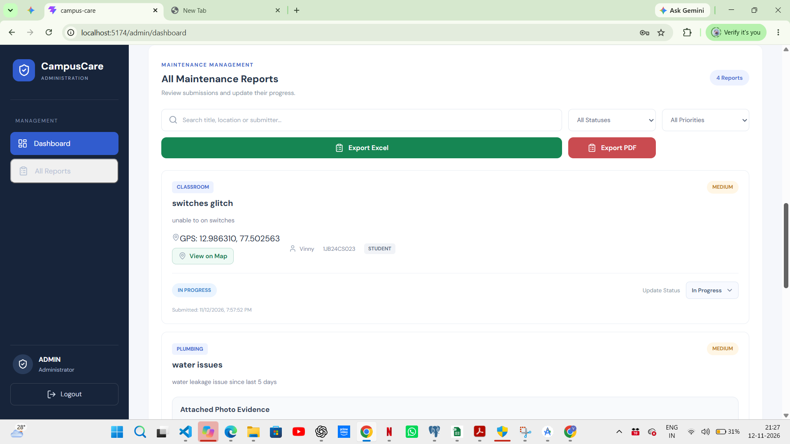

# CampusCare – College Maintenance & Report Tracking System

A web-based campus maintenance management system that helps students and faculty report infrastructure issues and enables administrators to track, manage, and resolve maintenance requests efficiently.

## About the Project

CampusCare is designed to digitize the college maintenance complaint process. Instead of relying on manual complaints and follow-ups, users can submit maintenance requests online, monitor their progress, and receive status updates.

Administrators can view submitted reports, manage maintenance requests, and update their resolution status through an administrative interface.

## Key Features

### Student & Faculty
- User registration and login.
- Secure authentication using JWT.
- Email verification.
- Forgot password and OTP-based password reset.
- Submit maintenance reports with descriptions, categories, locations, and images.
- View previously submitted reports.
- Track report status and administrative updates.

### Administrator
- Secure administrator access.
- View submitted maintenance reports.
- Manage maintenance requests.
- Update report status.
- Monitor maintenance activity through the administrative dashboard.

### Additional Features
- Image upload and viewing.
- Role-based access control.
- PostgreSQL database integration.
- Responsive React frontend.

## Technology Stack

| Layer | Technologies |
|---|---|
| Frontend | React.js, Vite, JavaScript |
| Styling | CSS |
| Backend | Java, Spring Boot |
| Security | Spring Security, JWT |
| Database | PostgreSQL |
| ORM | Spring Data JPA, Hibernate |
| Build Tool | Maven |
| Version Control | Git, GitHub |

## System Architecture

CampusCare follows a frontend-backend architecture.

```text
             STUDENT / FACULTY / ADMIN
                        |
                        v
               React Frontend
                 (Vite)
                        |
                   REST APIs
                        |
                        v
              Spring Boot Backend
                        |
             +----------+----------+
             |          |          |
             v          v          v
         Security    Controllers  Services
         (JWT)                     |
                                   v
                            Spring Data JPA
                                   |
                                   v
                              PostgreSQL
```

## Project Structure

```text
campus-care/
|
|-- backend/
|   |-- campuscare-backend/
|       |-- src/
|       |-- pom.xml
|       |-- src/main/resources/
|           |-- application-example.properties
|
|-- public/
|-- src/
|   |-- components/
|   |-- pages/
|   |-- App.jsx
|   |-- main.jsx
|
|-- package.json
|-- README.md
|-- .gitignore
```

## Getting Started

### Prerequisites

Install the following:

- Node.js and npm
- Java 21
- PostgreSQL
- Git

### 1. Clone the Repository

```bash
git clone https://github.com/DEEKSHA13062006/CampusCare.git
cd campus-care
```

### 2. Configure the Database

Create a PostgreSQL database named:

```sql
CREATE DATABASE campuscare_db;
```

Configure the required environment variables for the backend:

```text
DB_USERNAME
DB_PASSWORD
JWT_SECRET
MAIL_USERNAME
MAIL_PASSWORD
```

Use the supplied `application-example.properties` as a configuration reference.

Do not commit real passwords, JWT secrets, email credentials, or private configuration files.

### 3. Start the Backend

Open a terminal:

```bash
cd backend/campuscare-backend
```

Configure the environment variables in your system, then run:

```bash
.\mvnw.cmd spring-boot:run
```

Backend address:

```text
http://localhost:8080
```

### 4. Start the Frontend

Open another terminal from the project root:

```bash
npm install
npm run dev
```

Open the local development URL displayed by Vite, usually:

```text
http://localhost:5173
```

## Application Workflow

1. A student or faculty member registers and verifies their account.
2. The user logs into CampusCare.
3. The user submits a maintenance report.
4. The report is stored in the PostgreSQL database.
5. An administrator views the submitted report.
6. The administrator updates its status.
7. The student can view the updated status through My Reports.

## Security

- JWT-based authentication.
- Password hashing.
- Role-based authorization.
- Protected administrative endpoints.
- Environment-based configuration for sensitive credentials.
- CORS configuration for local frontend development.

## Future Enhancements

- Real-time maintenance notifications.
- Maintenance assignment to specific staff members.
- Advanced analytics and reporting.
- Report filtering and search improvements.
- Deployment to a cloud hosting platform.

## Project Information

- **Project Name:** CampusCare
- **Category:** Full-Stack Web Application
- **Domain:** College Maintenance Management
- **Frontend:** React.js
- **Backend:** Spring Boot
- **Database:** PostgreSQL

---

Developed as an academic software engineering project.
## Screenshots

### Login


### Student Dashboard


### Report an Issue


### My Reports


### Admin Dashboard


### Admin Reports
